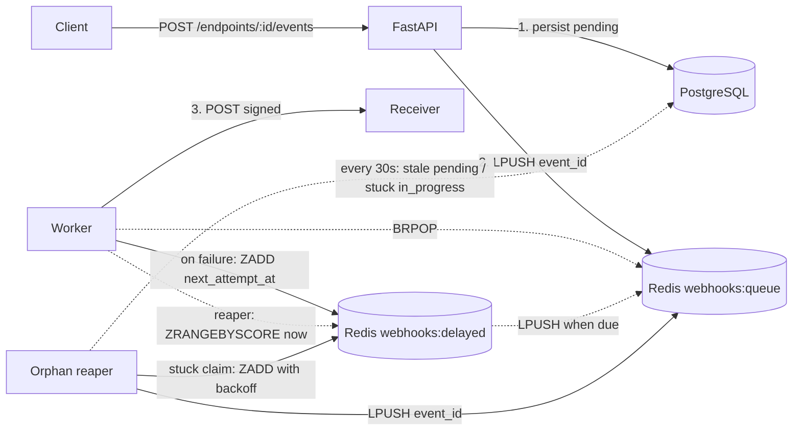

# HookRelay

[](https://github.com/ManuelRuizJ/hook-relay/actions/workflows/ci.yml)

A webhook delivery service built with FastAPI, PostgreSQL and Redis.

> Portfolio project for backend/infrastructure roles. Demonstrates multi-stage Docker builds, healthchecks, background workers, retries with exponential backoff, idempotency, a dead-letter queue, structured logging, Prometheus metrics and CI.

## Status

✅ All 6 phases complete.

## Roadmap

- [x] Repository bootstrap
- [x] PostgreSQL + Redis in Docker Compose
- [x] Minimal FastAPI with `/health`
- [x] Multi-stage Dockerfile
- [x] Webhook endpoint CRUD
- [x] Event ingestion
- [x] Delivery worker with retries
- [x] Reliability: orphan and stuck-claim recovery
- [x] Dead-letter queue
- [x] Observability: JSON logs, Prometheus metrics, readiness probe
- [x] CI

## Architecture



PostgreSQL is the source of truth: an event is committed before it is enqueued. If Redis is unavailable, or a worker stops between `BRPOP` and claiming the event, the event stays `pending` in PostgreSQL and the orphan reaper re-enqueues it. If a worker stops in the middle of a delivery, the reaper releases the expired `in_progress` claim and schedules a retry. This provides at-least-once delivery, so receivers must be idempotent.

## How to run

**Prerequisites:** Docker and Docker Compose.

```bash
# 1. Clone
git clone https://github.com/<you>/hookrelay.git
cd hookrelay

# 2. Configure
cp .env.example .env
echo "HOST_UID=$(id -u)" >> .env
echo "HOST_GID=$(id -g)" >> .env

# 3. Start (API + worker + PostgreSQL + Redis)
docker compose up --build -d

# 4. Wait for the API healthcheck
until curl -sf http://localhost:8000/health > /dev/null; do sleep 1; done

# 5. Open the interactive API documentation
xdg-open http://localhost:8000/docs
```

For production, run Compose without the development override:

```bash
docker compose -f docker-compose.yml up --build -d
```

## Services

| Service | Role | Ports |
|---|---|---|
| `api` | FastAPI HTTP server (ingest, query, DLQ, `/metrics`, health probes) | `8000` |
| `worker` | BRPOP loop, delivers events, retries and reaper; serves its own `/metrics` | `9100` (published in dev only) |
| `db` | PostgreSQL 16 | Internal |
| `redis` | Redis 7 (queue + delayed sorted set) | Internal |

## API

### Webhook endpoints

| Method | Path | Description |
|---|---|---|
| `POST` | `/api/v1/endpoints` | Create an endpoint. Returns the signing secret once. |
| `GET` | `/api/v1/endpoints` | List endpoints (secret is never returned). |
| `GET` | `/api/v1/endpoints/{id}` | Get one endpoint. |
| `PATCH` | `/api/v1/endpoints/{id}` | Update URL, description or `is_active`. |
| `DELETE` | `/api/v1/endpoints/{id}` | Delete an endpoint (cascades to its events). |

### Events

| Method | Path | Description |
|---|---|---|
| `POST` | `/api/v1/endpoints/{id}/events` | Ingest an event. Returns `201` with `status: "pending"`. |
| `GET` | `/api/v1/events/{id}` | Get event status, attempts, `next_attempt_at`, `last_error` and `delivered_at`. |

### Dead-letter queue

| Method | Path | Description |
|---|---|---|
| `GET` | `/api/v1/dead-letters` | List `failed` events, most recently failed first. Filters: `endpoint_id`, `skip`, `limit`. |
| `POST` | `/api/v1/events/{id}/replay` | `failed` or `dead` → `pending` with `attempts` reset to 0, then re-enqueued. `409` for any other status or an inactive endpoint. |
| `POST` | `/api/v1/events/{id}/discard` | `failed` → `dead`: archived for audit and hidden from the listing. Can still be replayed. |

```bash
# Inspect the dead-letter queue, then replay one event after fixing the receiver
curl -s http://localhost:8000/api/v1/dead-letters
curl -s -X POST "http://localhost:8000/api/v1/events/$EVENT_ID/replay"
```

## Quick start

Create an endpoint, save its returned ID and signing secret, and then submit an event:

```bash
# Create an endpoint
RESP=$(curl -s -X POST http://localhost:8000/api/v1/endpoints \
  -H "Content-Type: application/json" \
  -d '{"url":"https://example.com/hooks","description":"demo"}')

ENDPOINT_ID=$(echo "$RESP" | python -c "import sys,json;print(json.load(sys.stdin)['id'])")

# Ingest an event
curl -s -X POST "http://localhost:8000/api/v1/endpoints/$ENDPOINT_ID/events" \
  -H "Content-Type: application/json" \
  -d '{"event_type":"order.created","payload":{"order_id":42}}'

# Watch the worker process the delivery
docker compose logs -f worker
```

## Event lifecycle

```text
pending ──claim──▶ in_progress ──success──▶ delivered
   ▲                    │
   │                    ├──failure, attempts < max──▶ pending (with next_attempt_at)
   │                    │                                │
   │                    │                                └──▶ webhooks:delayed ZSET
   │                    │                                        │
   │                    │                                        └──reaper (when due)
   │                    │                                                │
   └────────────────────┴────────────────────────────────────────────────┘

                       ├──failure, attempts = max──▶ failed (dead-letter queue)
                       │                                  │
                       │                                  ├──replay──▶ pending (attempts = 0)
                       │                                  └──discard──▶ dead ──replay──▶ pending
                       │
                       └──claim older than 120s (worker lost)──▶ same rule as a failure
```

`attempts` is incremented when an event is claimed, so it represents the number of HTTP delivery attempts made.

`in_progress` represents an active claim. It lets the reaper distinguish an event being delivered from one abandoned by a worker that stopped unexpectedly.

**Orphan recovery:** a `pending` event whose `next_attempt_at` is more than 30s in the past has no path back to the queue (the worker died before claiming it, or `LPUSH` failed after the commit). The orphan reaper runs every 30s inside the worker, pushes `next_attempt_at` forward another 30s and re-enqueues the event. `in_progress` events are not touched by this pass.

**Stuck claim recovery:** an event that stays `in_progress` for more than 120s was claimed by a worker that died mid-delivery (a live delivery is bounded by the HTTP timeout, about 25s). The same reaper task releases it with the rule used for a failed delivery: the lost attempt is not refunded, so the event goes back to `pending` with backoff on `webhooks:delayed`, or to `failed` when `max_attempts` is spent. `last_error` is set to `worker lost claim: in_progress timeout`.

**Dead-letter queue:** an event whose retries are exhausted stays in PostgreSQL as `failed`, with its `last_error`. An operator either replays it, which gives it a fresh `max_attempts` budget, or discards it to `dead`, which keeps it for audit without listing it. Replay is rejected while the endpoint is inactive, since it would fail again.

**Retry backoff:** 2s → 4s → 8s → 16s, capped at 5 minutes, with 0–10% jitter to reduce thundering-herd effects.

## Observability

### Logs

Both services write one JSON object per line to stdout. Identifiers are fields, not just message text, so one event's history is a single filter:

```bash
docker compose logs worker --no-log-prefix | jq -c 'select(.event_id == "<id>")'
```

```json
{"ts": "2026-11-13T04:16:01.027+00:00", "level": "INFO", "logger": "app.worker.main", "msg": "Event … scheduled for retry after attempt 1 (next at …)", "event_id": "…", "endpoint_id": "…", "attempt": 1, "next_attempt_at": "…"}
```

| Field | Where |
|---|---|
| `event_id`, `endpoint_id`, `attempt` | Every delivery outcome |
| `url`, `status_code`, `duration_ms` | The HTTP call to the receiver |
| `next_attempt_at` / `last_error` | Retries / dead-lettered events |
| `count`, `rescheduled`, `failed` | Reaper passes |
| `exc_info` | Tracebacks, kept inside the JSON line |

Set `LOG_FORMAT=text` for human-readable lines while developing. Uvicorn's own startup and access logs go through the same formatter (the first two startup lines are printed before the app configures logging and stay in uvicorn's format).

### Metrics

The API and the worker are separate processes, so each exposes its own Prometheus endpoint:

| Process | Endpoint | Metric | Meaning |
|---|---|---|---|
| API | `:8000/metrics` | `hookrelay_http_requests_total{method,route,status}` | Requests by route template (`route="unmatched"` for unknown paths) |
| | | `hookrelay_http_request_duration_seconds{method,route}` | Request latency |
| | | `hookrelay_queue_depth{queue="delivery"\|"delayed"}` | Events waiting in Redis |
| | | `hookrelay_events{status}` | Events per status; `status="failed"` is the DLQ size |
| Worker | `:9100/metrics` | `hookrelay_deliveries_total{outcome="delivered"\|"retry"\|"failed"}` | Delivery outcomes |
| | | `hookrelay_delivery_duration_seconds` | Time of the POST to the receiver |
| | | `hookrelay_reaper_recovered_total{kind}` | `orphaned`, `stuck_rescheduled`, `stuck_failed` |
| | | `hookrelay_reaper_errors_total{pass_name}` | Reaper passes that raised |
| | | `hookrelay_worker_loop_errors_total` | Main-loop iterations retried after an outage |

Queue depth and events by status are read from Redis and PostgreSQL at scrape time, so they always match the source of truth.

Example Prometheus scrape configuration on the Compose network:

```yaml
scrape_configs:
  - job_name: hookrelay-api
    static_configs: [{targets: ["api:8000"]}]
  - job_name: hookrelay-worker
    static_configs: [{targets: ["worker:9100"]}]
```

Useful queries:

```promql
# Delivery success ratio over 5 minutes
sum(rate(hookrelay_deliveries_total{outcome="delivered"}[5m]))
  / sum(rate(hookrelay_deliveries_total[5m]))

# p95 latency of receivers
histogram_quantile(0.95, sum by (le) (rate(hookrelay_delivery_duration_seconds_bucket[5m])))

# Dead-letter queue size (alert when > 0)
hookrelay_events{status="failed"}
```

### Health probes

| Endpoint | Type | Checks | Use it for |
|---|---|---|---|
| `GET /health` | Liveness | Nothing; the process answers | Restarting a hung container (the Compose healthcheck) |
| `GET /health/ready` | Readiness | `SELECT 1` on PostgreSQL and `PING` on Redis, 2s timeout each | Routing traffic; returns `503` naming the failing check |

```bash
$ curl -s localhost:8000/health/ready
{"status":"unavailable","checks":{"postgres":"ok","redis":"error: TimeoutError"}}
```

Failed checks report only the exception type; connection details stay in the logs.

## Signed deliveries

Every delivery POST includes these headers:

```text
X-HookRelay-Id: <event uuid>
X-HookRelay-Event: <event_type>
X-HookRelay-Timestamp: <unix seconds>
X-HookRelay-Signature: sha256=<hex>
User-Agent: HookRelay/0.4
```

The signature is calculated as `HMAC-SHA256(secret, "{timestamp}.{body}")`. The timestamp is part of the signed message, allowing receivers to reject stale deliveries and reduce replay risk.

### Receiver verification example

The receiver must calculate the signature using the exact raw request body:

```python
import hashlib
import hmac
import time

expected = hmac.new(
    secret.encode(),
    f"{timestamp}.".encode() + raw_body,
    hashlib.sha256,
).hexdigest()

assert hmac.compare_digest(expected, received_sig)
assert abs(time.time() - int(timestamp)) < 300  # 5-minute window
```

## Design notes

The following implementation decisions are useful to understand when reviewing the project:

- **Redis lists, not pub/sub.** `LPUSH` + `BRPOP` keeps queued messages until they are consumed. Pub/sub can lose messages when no consumer is connected.

- **Commit before enqueue.** If `LPUSH` fails after the database commit, the event remains in PostgreSQL with `pending` status. The API returns `201` because the resource was created; delivery is handled separately.

- **Delayed retries with a sorted set.** Failed events are added to `webhooks:delayed`, with `next_attempt_at` as the score. A reaper uses `ZRANGEBYSCORE`, `ZREM` and `LPUSH` to return due events to the queue. This avoids sleeping inside the worker.

- **Orphan reaper as a sibling task.** A second asyncio task in the worker process scans PostgreSQL every 30s for stale `pending` events (batches of 100, oldest first) using `SELECT ... FOR UPDATE SKIP LOCKED`, so several reapers never double-enqueue. It advances `next_attempt_at` before `LPUSH` to avoid re-picking the same event on the next cycle. A failed cycle is logged and retried; it never stops the worker, and the task is cancelled cleanly on shutdown.

- **Claim timeout from `updated_at`, no extra column.** `mark_in_progress` is the last write to an `in_progress` row, so `updated_at` already records the claim time. The 120s timeout is roughly five times the worst-case HTTP timeout, so a slow but live worker is not preempted. If one ever were, the event could be delivered twice, which at-least-once delivery already allows.

- **PostgreSQL is the dead-letter queue.** `failed` already means "retries exhausted", so the DLQ is a query, not a second store. A Redis list would duplicate that state and could drift from it. Replay and discard lock the row (`SELECT ... FOR UPDATE`), so a double-clicked replay enqueues the event once and the second request gets `409`. Replay follows the ingestion contract: commit, then best-effort `LPUSH`, with the orphan reaper as the fallback.

- **Flat `/events/{id}` route.** Event IDs are UUIDs, so the parent endpoint is not required to retrieve an event.

- **Secret returned once.** Only the response schema used by `POST /endpoints` exposes the signing secret. Listing and retrieving endpoints do not return it.

- **Non-root container.** The `appuser` account maps to the host UID/GID through build arguments, allowing bind mounts and Alembic revision generation without `sudo`.

- **One image, two entrypoints.** The API and worker share the same Docker image. The Compose service command determines which process runs.

- **Liveness and readiness are separate.** `/health` never touches PostgreSQL or Redis, so a database outage does not get the API restarted in a loop. `/health/ready` is what decides whether traffic should reach it.

- **State gauges are computed at scrape time.** Queue depth and events by status come from `LLEN`/`ZCARD` and a `GROUP BY status` query on each scrape instead of in-memory counters, which would reset on restart and drift between processes.

- **The worker survives outages.** A Redis or PostgreSQL error in the main loop is logged and retried with backoff (1s up to 30s) instead of ending the process, and Compose restarts `api` and `worker` if they ever exit. An event interrupted mid-flight is recovered by the reaper.

## Development

The development override (`docker-compose.override.yml`, applied automatically by Docker Compose) bind-mounts `app/`, `tests/` and `alembic/`, and runs Uvicorn with `--reload`.

Changes to mounted application files are reflected without rebuilding the image. A rebuild is needed when changing the Dockerfile, dependencies or Compose configuration.

```bash
# Run tests
docker compose exec api pytest -v

# Generate a migration after editing models
docker compose exec api alembic revision --autogenerate -m "message"
docker compose exec api alembic upgrade head

# Follow worker logs
docker compose logs -f worker

# Lint and format (same ruff version as CI)
docker run --rm -v "$PWD":/src -w /src ghcr.io/astral-sh/ruff:0.8.4 check .
docker run --rm -v "$PWD":/src -w /src ghcr.io/astral-sh/ruff:0.8.4 format .
```

Ruff is configured in `pyproject.toml`. It can also run from a virtualenv with `pip install -r requirements-dev.txt`. To make `git blame` skip the bulk formatting commits:

```bash
git config blame.ignoreRevsFile .git-blame-ignore-revs
```

### Continuous integration

`.github/workflows/ci.yml` runs on every pull request and on pushes to `main`:

| Job | What it checks |
|---|---|
| Lint | `ruff check` and `ruff format --check` |
| Tests | Postgres 16 and Redis 7 service containers, migrations applied from scratch, `alembic check` for model/migration drift, then `pytest` |
| Docker image | The production Dockerfile builds |

## Troubleshooting

### `curl: (56) Recv failure` immediately after `up -d`

Uvicorn may still be starting. Wait for the API healthcheck:

```bash
until curl -sf http://localhost:8000/health > /dev/null; do sleep 1; done
```

### Event stuck in `pending` with `attempts=0`

Check whether the worker is running:

```bash
docker compose ps
```

If a worker stopped after retrieving a message but before marking the event as `in_progress`, the event remains pending. The orphan reaper re-enqueues it within about a minute (30s staleness threshold + 30s interval). Confirm it in the worker logs:

```bash
docker compose logs worker | grep -iE "orphan|re-queued"
```

If no `Re-queued N orphaned event(s)` line appears, look for `Reaper cycle failed` in the same logs.

### Event stuck in `in_progress`

The worker that claimed it stopped during the delivery. After 120s the reaper releases the claim on its next cycle (within about 2.5 minutes in total) and reschedules or fails the event:

```bash
docker compose logs worker | grep "stuck in_progress"
```

Expect `Released N stuck in_progress event(s): X rescheduled, Y failed`.

### Worker logs `Worker loop failed; retrying in Ns`

Redis or PostgreSQL is unreachable. The worker keeps retrying with backoff (up to 30s) and logs `Worker loop recovered after N failure(s)` once the dependency is back. Check the dependencies:

```bash
curl -s localhost:8000/health/ready
docker compose ps
```

### Two workers are processing the queue

This can happen if a manually started worker is running while the Compose `worker` service is also active. Stop the manually started process and use the Compose worker service:

```bash
docker compose logs -f worker
```

### Address already in use on port 9000 in the test receiver

A previous test receiver may still be listening on port `9000`. Reuse that process or stop it before starting another receiver.

### Can't locate revision in Alembic

The database may point to a migration revision whose file is missing. If this is a disposable development database and you are comfortable deleting its data, reset the Compose volumes:

```bash
docker compose down -v
docker compose up --build -d
```

**Warning:** `docker compose down -v` deletes the database volume and its data. Do not use it if you need to preserve data.

### `PermissionError` in `alembic/versions/`

The container UID/GID may not match the host user. Check that `HOST_UID` and `HOST_GID` in `.env` match:

```bash
id -u
id -g
```
