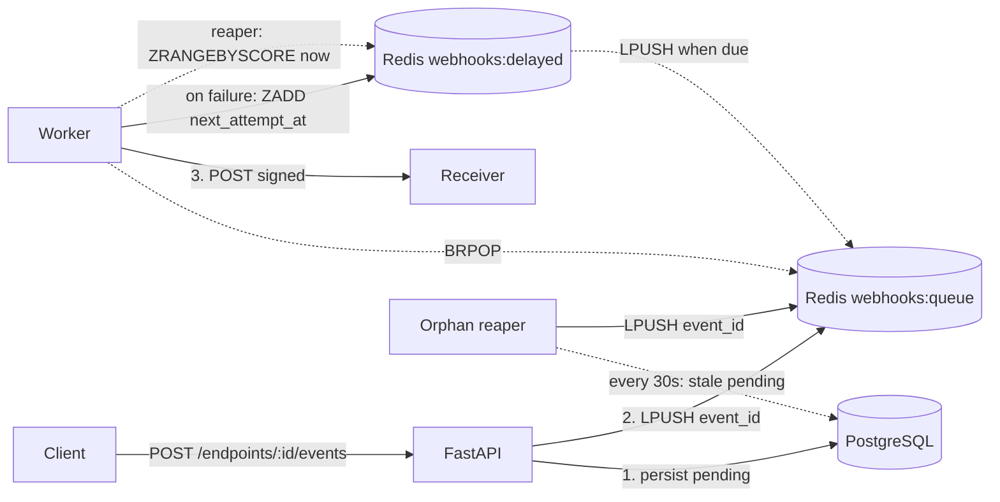

# HookRelay

A webhook delivery service built with FastAPI, PostgreSQL and Redis.

> Portfolio project for backend/infrastructure roles. Demonstrates multi-stage Docker builds, healthchecks, background workers, retries with exponential backoff, idempotency and a dead-letter queue.

## Status

🚧 Under construction — Phase 4 of 6 complete.

## Roadmap

- [x] Repository bootstrap
- [x] PostgreSQL + Redis in Docker Compose
- [x] Minimal FastAPI with `/health`
- [x] Multi-stage Dockerfile
- [x] Webhook endpoint CRUD
- [x] Event ingestion
- [x] Delivery worker with retries
- [ ] Dead-letter queue
- [ ] Observability
- [ ] CI

## Architecture



PostgreSQL is the source of truth: an event is committed before it is enqueued. If Redis is unavailable, or a worker stops between `BRPOP` and claiming the event, the event stays `pending` in PostgreSQL and the orphan reaper re-enqueues it. This provides at-least-once delivery, so receivers must be idempotent.

## How to run

**Prerequisites:** Docker and Docker Compose.

```bash
# 1. Clone
git clone https://github.com/<you>/hookrelay.git
cd hookrelay

# 2. Configure
cp .env.example .env
echo "HOST_UID=$(id -u)" >> .env
echo "HOST_GID=$(id -g)" >> .env

# 3. Start (API + worker + PostgreSQL + Redis)
docker compose up --build -d

# 4. Wait for the API healthcheck
until curl -sf http://localhost:8000/health > /dev/null; do sleep 1; done

# 5. Open the interactive API documentation
xdg-open http://localhost:8000/docs
```

For production, run Compose without the development override:

```bash
docker compose -f docker-compose.yml up --build -d
```

## Services

| Service | Role | Ports |
|---|---|---|
| `api` | FastAPI HTTP server (ingest + query) | `8000` |
| `worker` | BRPOP loop, delivers events and handles retries | — |
| `db` | PostgreSQL 16 | Internal |
| `redis` | Redis 7 (queue + delayed sorted set) | Internal |

## API

### Webhook endpoints

| Method | Path | Description |
|---|---|---|
| `POST` | `/api/v1/endpoints` | Create an endpoint. Returns the signing secret once. |
| `GET` | `/api/v1/endpoints` | List endpoints (secret is never returned). |
| `GET` | `/api/v1/endpoints/{id}` | Get one endpoint. |
| `PATCH` | `/api/v1/endpoints/{id}` | Update URL, description or `is_active`. |
| `DELETE` | `/api/v1/endpoints/{id}` | Delete an endpoint (cascades to its events). |

### Events

| Method | Path | Description |
|---|---|---|
| `POST` | `/api/v1/endpoints/{id}/events` | Ingest an event. Returns `201` with `status: "pending"`. |
| `GET` | `/api/v1/events/{id}` | Get event status, attempts, `next_attempt_at`, `last_error` and `delivered_at`. |

## Quick start

Create an endpoint, save its returned ID and signing secret, and then submit an event:

```bash
# Create an endpoint
RESP=$(curl -s -X POST http://localhost:8000/api/v1/endpoints \
  -H "Content-Type: application/json" \
  -d '{"url":"https://example.com/hooks","description":"demo"}')

ENDPOINT_ID=$(echo "$RESP" | python -c "import sys,json;print(json.load(sys.stdin)['id'])")

# Ingest an event
curl -s -X POST "http://localhost:8000/api/v1/endpoints/$ENDPOINT_ID/events" \
  -H "Content-Type: application/json" \
  -d '{"event_type":"order.created","payload":{"order_id":42}}'

# Watch the worker process the delivery
docker compose logs -f worker
```

## Event lifecycle

```text
pending ──claim──▶ in_progress ──success──▶ delivered
   ▲                    │
   │                    ├──failure, attempts < max──▶ pending (with next_attempt_at)
   │                    │                                │
   │                    │                                └──▶ webhooks:delayed ZSET
   │                    │                                        │
   │                    │                                        └──reaper (when due)
   │                    │                                                │
   └────────────────────┴────────────────────────────────────────────────┘

                       └──failure, attempts = max──▶ failed (Phase 5: DLQ)
```

`attempts` is incremented when an event is claimed, so it represents the number of HTTP delivery attempts made.

`in_progress` represents an active claim. It lets the reaper distinguish an event being delivered from one abandoned by a worker that stopped unexpectedly.

**Orphan recovery:** a `pending` event whose `next_attempt_at` is more than 30s in the past has no path back to the queue (the worker died before claiming it, or `LPUSH` failed after the commit). The orphan reaper runs every 30s inside the worker, pushes `next_attempt_at` forward another 30s and re-enqueues the event. `in_progress` events are not touched by this reaper.

**Retry backoff:** 2s → 4s → 8s → 16s, capped at 5 minutes, with 0–10% jitter to reduce thundering-herd effects.

## Signed deliveries

Every delivery POST includes these headers:

```text
X-HookRelay-Id: <event uuid>
X-HookRelay-Event: <event_type>
X-HookRelay-Timestamp: <unix seconds>
X-HookRelay-Signature: sha256=<hex>
User-Agent: HookRelay/0.4
```

The signature is calculated as `HMAC-SHA256(secret, "{timestamp}.{body}")`. The timestamp is part of the signed message, allowing receivers to reject stale deliveries and reduce replay risk.

### Receiver verification example

The receiver must calculate the signature using the exact raw request body:

```python
import hashlib
import hmac
import time

expected = hmac.new(
    secret.encode(),
    f"{timestamp}.".encode() + raw_body,
    hashlib.sha256,
).hexdigest()

assert hmac.compare_digest(expected, received_sig)
assert abs(time.time() - int(timestamp)) < 300  # 5-minute window
```

## Design notes

The following implementation decisions are useful to understand when reviewing the project:

- **Redis lists, not pub/sub.** `LPUSH` + `BRPOP` keeps queued messages until they are consumed. Pub/sub can lose messages when no consumer is connected.

- **Commit before enqueue.** If `LPUSH` fails after the database commit, the event remains in PostgreSQL with `pending` status. The API returns `201` because the resource was created; delivery is handled separately.

- **Delayed retries with a sorted set.** Failed events are added to `webhooks:delayed`, with `next_attempt_at` as the score. A reaper uses `ZRANGEBYSCORE`, `ZREM` and `LPUSH` to return due events to the queue. This avoids sleeping inside the worker.

- **Orphan reaper as a sibling task.** A second asyncio task in the worker process scans PostgreSQL every 30s for stale `pending` events (batches of 100, oldest first) using `SELECT ... FOR UPDATE SKIP LOCKED`, so several reapers never double-enqueue. It advances `next_attempt_at` before `LPUSH` to avoid re-picking the same event on the next cycle. A failed cycle is logged and retried; it never stops the worker, and the task is cancelled cleanly on shutdown.

- **Flat `/events/{id}` route.** Event IDs are UUIDs, so the parent endpoint is not required to retrieve an event.

- **Secret returned once.** Only the response schema used by `POST /endpoints` exposes the signing secret. Listing and retrieving endpoints do not return it.

- **Non-root container.** The `appuser` account maps to the host UID/GID through build arguments, allowing bind mounts and Alembic revision generation without `sudo`.

- **One image, two entrypoints.** The API and worker share the same Docker image. The Compose service command determines which process runs.

## Development

The development override (`docker-compose.override.yml`, applied automatically by Docker Compose) bind-mounts `app/`, `tests/` and `alembic/`, and runs Uvicorn with `--reload`.

Changes to mounted application files are reflected without rebuilding the image. A rebuild is needed when changing the Dockerfile, dependencies or Compose configuration.

```bash
# Run tests
docker compose exec api pytest -v

# Generate a migration after editing models
docker compose exec api alembic revision --autogenerate -m "message"
docker compose exec api alembic upgrade head

# Follow worker logs
docker compose logs -f worker
```

## Troubleshooting

### `curl: (56) Recv failure` immediately after `up -d`

Uvicorn may still be starting. Wait for the API healthcheck:

```bash
until curl -sf http://localhost:8000/health > /dev/null; do sleep 1; done
```

### Event stuck in `pending` with `attempts=0`

Check whether the worker is running:

```bash
docker compose ps
```

If a worker stopped after retrieving a message but before marking the event as `in_progress`, the event remains pending. The orphan reaper re-enqueues it within about a minute (30s staleness threshold + 30s interval). Confirm it in the worker logs:

```bash
docker compose logs worker | grep -iE "orphan|re-queued"
```

If no `Re-queued N orphaned event(s)` line appears, look for `Reaper cycle failed` in the same logs.

### Two workers are processing the queue

This can happen if a manually started worker is running while the Compose `worker` service is also active. Stop the manually started process and use the Compose worker service:

```bash
docker compose logs -f worker
```

### Address already in use on port 9000 in the test receiver

A previous test receiver may still be listening on port `9000`. Reuse that process or stop it before starting another receiver.

### Can't locate revision in Alembic

The database may point to a migration revision whose file is missing. If this is a disposable development database and you are comfortable deleting its data, reset the Compose volumes:

```bash
docker compose down -v
docker compose up --build -d
```

**Warning:** `docker compose down -v` deletes the database volume and its data. Do not use it if you need to preserve data.

### `PermissionError` in `alembic/versions/`

The container UID/GID may not match the host user. Check that `HOST_UID` and `HOST_GID` in `.env` match:

```bash
id -u
id -g
```
