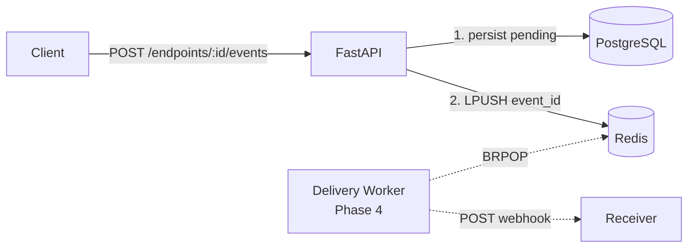

# HookRelay

A webhook delivery service built with FastAPI, PostgreSQL and Redis.

> Portfolio project for backend/infrastructure roles. Demonstrates multi-stage Docker builds,
> healthchecks, background workers, retries with exponential backoff, idempotency
> and a dead-letter queue.

## Status

. . . 3 / 6

## Roadmap

- [x] Repository bootstrap
- [x] PostgreSQL + Redis in Docker Compose
- [x] Minimal FastAPI with `/health`
- [x] Multi-stage Dockerfile
- [x] Webhook endpoint CRUD
- [x] Event ingestion
- [ ] Delivery worker with retries
- [ ] Dead-letter queue
- [ ] Observability
- [ ] CI


## API
### `POST /api/v1/endpoints`
Create a webhook endpoint. Returns the signing **secret once** — store it.

```bash
curl -X POST http://localhost:8000/api/v1/endpoints \
  -H "Content-Type: application/json" \
  -d '{"url":"https://example.com/hooks","description":"demo"}'

## How to run
GET /api/v1/endpoints?skip=0&limit=100

# List endpoints (secret is never returned).

GET /api/v1/endpoints/{id}
PATCH /api/v1/endpoints/{id}
DELETE /api/v1/endpoints/{id}
```

## Architecture



Postgres is the source of truth: an event is committed before it is enqueued. If Redis is unavailable the event stays pending and the Phase 5 reaper re-enqueues it — at-least-once delivery, receivers must be idempotent.

## How to run

Prerequisites: Docker and Docker Compose.

```bash
# 1. Clone
git clone https://github.com/ManuelRuizJ/hookrelay.git
cd hookrelay

# 2. Configure
cp .env.example .env
echo "HOST_UID=$(id -u)" >> .env
echo "HOST_GID=$(id -g)" >> .env

# 3. Start
docker compose up --build -d

# 4. Wait for health
until curl -sf http://localhost:8000/health > /dev/null; do sleep 1; done

# 5. Open the interactive docs
open http://localhost:8000/docs
# or xdg-open / your browser
```

For production, drop the dev overrides:

```bash
docker compose -f docker-compose.yml up --build -d
```

## API

### Webhook endpoints

| Method | Path | Description |
|---|---|---|
| POST | `/api/v1/endpoints` | Create an endpoint. Returns the signing secret once. |
| GET | `/api/v1/endpoints` | List endpoints (secret is never returned). |
| GET | `/api/v1/endpoints/{id}` | Get one endpoint. |
| PATCH | `/api/v1/endpoints/{id}` | Update url, description or is_active. |
| DELETE | `/api/v1/endpoints/{id}` | Delete (cascades events). |

### Events

| Method | Path | Description |
|---|---|---|
| POST | `/api/v1/endpoints/{id}/events` | Ingest an event. Returns 201 with status: "pending". |
| GET | `/api/v1/events/{id}` | Operational status: attempts, next_attempt_at, last_error. |

## Quick start

```bash
# Create an endpoint and keep the returned id + secret
RESP=$(curl -s -X POST http://localhost:8000/api/v1/endpoints \
  -H "Content-Type: application/json" \
  -d '{"url":"https://example.com/hooks","description":"demo"}')

ENDPOINT_ID=$(echo "$RESP" | python -c "import sys,json;print(json.load(sys.stdin)['id'])")

# Ingest an event
curl -s -X POST "http://localhost:8000/api/v1/endpoints/$ENDPOINT_ID/events" \
  -H "Content-Type: application/json" \
  -d '{"event_type":"order.created","payload":{"order_id":42}}'

# Inspect the queue
docker compose exec redis redis-cli LLEN webhooks:queue
```

## Design notes

Decisions that are easy to miss in code review, documented here so they are visible at a glance:

- **Redis lists, not pub/sub.** LPUSH + BRPOP because pub/sub loses messages when no consumer is connected. Lists are durable until consumed and give free queue-depth metrics via LLEN.

- **Commit before enqueue.** If LPUSH fails after commit, the event is still in Postgres as pending. The API returns 201 because the resource was created — delivery is a separate concern.

- **Flat `/events/{id}` route.** Event ids are UUIDs; the parent endpoint is not needed to resolve them.

- **Secret returned once.** Only WebhookEndpointWithSecret (used by POST /endpoints) exposes it. Listing and reading never do.

- **Alembic with async engine.** Configured in alembic/env.py to derive the URL from app.core.config.Settings.

- **Non-root container.** appuser maps to the host UID/GID via build args so bind mounts and alembic revision work without sudo.

## Development

The dev override (`docker-compose.override.yml`, applied automatically) bind-mounts `app/`, `tests/` and `alembic/`, and runs uvicorn with `--reload`. Edit a file, uvicorn reloads. No rebuild needed unless you change Dockerfile, requirements.txt or docker-compose.yml.

```bash
# Run tests
docker compose exec api pytest -v

# Generate a migration (after editing models)
docker compose exec api alembic revision --autogenerate -m "message"
docker compose exec api alembic upgrade head
```

## Troubleshooting

- **curl: (56) Recv failure right after up -d.** Uvicorn is still booting. Use `until curl -sf http://localhost:8000/health; do sleep 1; done` or check `docker compose ps` until api is healthy.

- **Can't locate revision in Alembic.** The DB points to a revision whose file was lost (e.g. generated inside an ephemeral container before the bind mount was added). `docker compose down -v && docker compose up -d` resets state.
